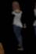
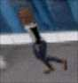
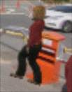
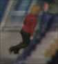
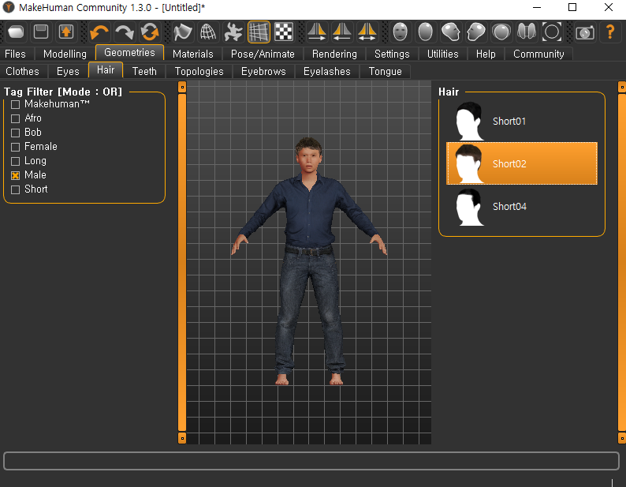

# Virtual Dataset — 360 파노라마 기반 합성 ReID 데이터셋 생성 파이프라인

360 파노라마 **한 장**으로 실내 공간을 3D로 복원하고, 그 안에 **가상 인물(GLB)** 을 투입해
가상 CCTV 시점에서 자동으로 관찰·크롭하여 **사람 재식별(ReID)/검출 학습용 데이터셋**을
만드는 자립형 도구임. 사람마다 ID를 부여한 **투영 GT**로 라벨을 공짜로 얻고, 같은 신원을
여러 맵(=여러 카메라)에 등장시켜 **cross-camera 쌍**을 자동 생성함.

> 최종 산출물: `pid_cam_frame` 규칙의 crop 이미지 + `list_train/query/gallery.txt` (**MSMT17 형태**).

---

## 왜 만드나 (Why)

CCTV용 사람 검출/추적(MOT)/재식별(ReID) 모델 학습에는 대량의 라벨 데이터가 필요함.
그러나 실데이터는 ① 라벨링 비용이 크고 ② ReID 핵심인 "같은 사람을 여러 각도/카메라에서"
모으기가 특히 어렵고 ③ 개인정보 이슈가 있음. 실제 공간을 3D로 복원하고 **위치·신원·포즈·의상을
모두 아는** 가상 인물을 심으면, 완벽한 정답 라벨과 cross-camera 쌍을 대규모로 확보함.

---

## 파이프라인

```
[신원 GLB 생성]        [파노라마 → 3D 맵]         [자동 수집]                 [데이터셋 조립]
MakeHuman/MPFB    →   업로드·경계·복원·bake   →   로스터 투입·동선 보행    →   신원 90/10 split
(walk_/run_ GLB)      면 삭제·화각·동선 저장       화각 3등분 트리거 crop        query/gallery + list
                      (maps/*.json)               (data/crops/)               (MSMT17: data/msmt_out/)
```

**맵 = 카메라.** 같은 신원을 여러 맵에 등장시키면 cross-camera ReID 쌍이 자동 생성됨.

---

## 예시 crop (자동 수집 결과)

실제 CCTV 영상처럼 열화(해상도 손실·블러·노이즈·JPEG)를 적용한 crop. 파일명이 곧 라벨임.
아래는 **같은 신원이 여러 카메라에 등장한** cross-camera 예시:

| `pid 1` · cam0 | `pid 1` · cam2 | `pid 2` · cam1 | `pid 2` · cam2 |
|:---:|:---:|:---:|:---:|
|  |  |  |  |

---

## 신원 GLB 생성 (MakeHuman / MPFB)

인물 에셋은 [MakeHuman](http://www.makehumancommunity.org/) + Blender **MPFB** 애드온으로 대량 생성함.
아래는 MakeHuman에서 헤어/의상 등을 조합하는 화면임.



*이미지 출처: MakeHuman Community 1.3.0*

배치 생성 스크립트(`scripts/`)로 걷기/뛰기 애니메이션이 적용된 GLB를 자동 생성함.
자세한 실행법은 [`scripts/README.md`](scripts/README.md) 참고.

```bat
cd /d E:\projects\virtual_dataset
python run_walk_run_30.py      :: walk 30 + run 30 GLB 생성
```

- 출력: `generated/walk/glb/`, `generated/run/glb/` (파일명 `person_XXXX.glb`)
- **접두사 규칙**: 애니메이션/출처별로 접두사를 붙여 신원을 구분함
  (예: `walk_person_0001.glb`, `run_person_0001.glb` → **서로 다른 pid**).

---

## 주요 기능

**저작 (뷰어)**
- 360 파노라마(2:1) 업로드 → 바닥/천장 경계 클릭 → 다각형 방(프리즘) 복원 + 6면 텍스처 bake
- Box Room 3D 뷰어: 드래그=시선, WASD=이동, Q/E=상하, 클릭=바닥 지정, 면 삭제
- **X축 반전**(handedness 보정, 기본 ON), 조명/밝기
- **주 동선(paths)**: 클릭으로 폴리라인 지정 → 사람은 그 방향으로 이동(평행 오프셋으로 자연 분산),
  동선 없으면 자유 배회
- **맵 저장/불러오기**: layout+텍스처+삭제면+바닥지정+화각+동선+반전을 이름 지정 JSON으로 저장(`maps/`)

**신원 로스터**
- GLB 풀 로드 → **원본 + 재색칠 변형**으로 원하는 인원(예 100+) 자동 생성
- 의상: 한국 의류 분포 반영해 **무채색(검정/회/흰) 위주**, 일부 은은한 색 / 머리: 검정·갈색
- pid는 파일명 기반으로 **모든 맵에서 고정**(재색칠도 pid 시드라 일관) → cross-camera 일관성
- 로스터 **미리보기**(썸네일 그리드), 저장/불러오기(`roster.json`)

**자동 수집**
- **점진 투입**: N명/분으로 시간차 누적, 현재 활동 인원 표시
- **투영 GT**: 3D 박스를 2D로 투영한 bbox+ID (ReID 정답)
- **트리거 캡처**: 사람 화면중심이 가로 1/3·2/3·3/3 선을 넘을 때 **전신·비가림**이면 자동 crop
- **crop 열화**: 해상도 손실·블러·노이즈·JPEG 압축으로 실제 CCTV 영상처럼
- **오케스트레이터**: `maps/` 전 맵을 자동 순회하며 커버리지대로 스폰·수집

**데이터셋 조립**
- 신원 **90/10** train/test split → test는 (pid,cam)당 1장 query·나머지 gallery → **MSMT17 형태**

**검증(옵션)**
- 캔버스 녹화 → 서버 YOLOv8 검출 → 하단에 bbox 재생(검출 난이도 확인용)

---

## 폴더 구조

```
virtual_dataset/
  web/                     # React + Vite + Three.js 프론트엔드 (저작·3D뷰어·투영GT·수집)
  server/                  # FastAPI 브리지 (+ yolov8n.pt)
    app.py
    data/                  # 런타임 산출물(업로드/bake/crops/msmt_out) — git 제외 권장
  tools/pano_projection/   # Python 코어: 투영/방복원/텍스처 bake/렌더/필터
  scripts/                 # MPFB 인물 배치 생성기
  maps/                    # 저장된 3D 맵(JSON). 파일명 정렬순 = camid
  generated/, mpfb_generated_v2/   # 생성된 인물 GLB 풀
  samples/                 # 테스트용 360 파노라마
  docs/                    # README 이미지 등
  requirements.txt
```

---

## 요구 사항

- **Python 3.11** + `requirements.txt` (torch·ultralytics·opencv·fastapi 등)
- **Node.js 18+**
- **ffmpeg** (PATH에 있어야 함 — `/api/detect`의 webm→mp4 트랜스코드)
- (인물 생성 시) **Blender 5.1** + **MPFB** 애드온

---

## 설치

```bash
# 1) Python 의존성 (torch가 커서 시간이 걸릴 수 있음)
pip install -r requirements.txt

# 2) 프론트엔드 의존성
cd web && npm install
```

---

## 실행 (터미널 2개)

```bash
# 터미널 1 — 백엔드 (:8000). 프로젝트 루트에서:
python -m uvicorn server.app:app --reload --port 8000

# 터미널 2 — 프론트엔드 (:3000)
cd web && npm run dev -- --host 0.0.0.0 --port 3000
```

브라우저에서 **http://localhost:3000** 접속. (`/api/*` 는 Vite 프록시로 :8000 전달 →
**백엔드를 먼저** 실행. 새 서버 엔드포인트를 추가/수정했으면 백엔드를 재시작.)

---

## 엔드투엔드 사용 흐름

### 1. 맵 만들기 (맵당 = 카메라 1대)
1. 파노라마 업로드(2:1) → 바닥/천장 경계 클릭
2. 방 복원 + 텍스처 굽기 → 필요 없는 면 삭제, **X축 반전** 확인
3. (선택) **주 동선** 그리기 — 사람 이동 방향 지정
4. 화각(카메라 시점) 맞추고 **맵 저장** → 원하는 이름으로 `maps/`에 저장
5. 여러 시점/공간을 각각 맵으로 저장 → 정렬 순서가 `camid`

### 2. 신원 로스터 준비
1. **GLB 풀 로드** — `generated/*/glb`, `mpfb_generated_v2/glb_bak` 등에서 인물 GLB 선택
2. **로스터 [100] 생성** → **로스터 미리보기**로 다양성 확인 → (선택) 저장

### 3. 자동 수집
1. 뷰어에서 **맵 목록 새로고침** (드롭다운에 `cam0 · …` 표시)
2. **전 맵 자동 수집** 영역: 커버리지(0.7)·동시인원·신원당 목표장수 설정 → **▶ 시작**
3. 맵이 자동으로 바뀌며 사람들이 걷고, 화각 3등분 통과 시 crop이 `data/crops/{mapId}/`에 쌓임

### 4. MSMT17 조립
- **MSMT17 조립** 버튼 → `data/msmt_out/` 생성

---

## MSMT17 출력 형식

```
data/msmt_out/
  train/   {pid:06d}_c{cam:03d}_{idx:07d}.jpg     # train 신원 이미지
  test/    {pid:06d}_c{cam:03d}_{idx:07d}.jpg     # test 신원 이미지
  list_train.txt      # "train/파일.jpg  pid  camid"
  list_query.txt      # test 신원, (pid,cam)당 1장
  list_gallery.txt    # test 신원 나머지
```

- 신원(pid) 90% train / 10% test로 완전 분리, cam = 맵 인덱스.
- crop 파일명 자체가 `pid_c{cam}_f{seq}`로 라벨을 담고 있어 커스텀 로더에서 파싱도 쉬움.

---

## 데이터셋 활용 (ReID)

이 합성 데이터는 **일반화(cross-domain) 성능 향상**에 특히 유효함. 권장 사용법:

- **합성 프리트레이닝 → 실데이터(Market1501/MSMT17) 파인튜닝** (가장 안정적)
- 여러 데이터셋 병합 학습 시 **pid를 전역 유니크하게 오프셋** + **도메인 균형 샘플링**
- 랜덤 의상·랜덤 동선·crop 열화가 sim-to-real 도메인 갭을 줄여 domain generalization에 기여

동일 도메인 테스트보다 **unseen/cross-domain 평가**에서 이득이 큼.

---

## 주요 API (server/app.py)

| 엔드포인트 | 역할 |
|---|---|
| `POST /api/upload` · `GET /api/image/{id}` | 파노라마 업로드/서빙 |
| `POST /api/layout` · `POST /api/bake-textures` · `GET /api/asset/{id}/{name}` | 방 복원·텍스처 |
| `POST /api/render-view` | 임의 CCTV 프레임 고품질 렌더(Python) |
| `GET /api/maps` · `GET /api/maps/{name}` | `maps/` 목록/서빙(camid=정렬 인덱스) |
| `POST /api/save-crops` | crop 저장(`data/crops/{mapId}/`) |
| `POST /api/build-msmt` | MSMT17 조립(split + query/gallery + list) |
| `POST /api/detect` | 녹화영상 → YOLOv8 프레임별 사람 bbox(검증용) |

---

## 알려진 한계

- 재색칠은 **색/명도**만 바꿈 — 옷 모양·패턴 다양성은 MPFB 자산 풀에 의존.
- 파노라마 1장 복원이라 가려진/먼 면 텍스처가 부족(확대 시 흐림), 단일 시점 한계.
- 자유 배회 맵은 트리거 통과가 불규칙 → 동선을 그리면 수집이 빠르고 고름.
- YOLOv8 CPU 추론은 느림(검증용이므로 녹화는 짧게).

---

## 크레딧 / 출처

- 인물 에셋: **MakeHuman Community** + Blender **MPFB** 애드온
- 검출 검증: **Ultralytics YOLOv8** (`yolov8n.pt`)
- 3D 렌더: **Three.js** / 백엔드: **FastAPI** / 프론트: **React + Vite**
- 데이터셋 형식: **MSMT17** 규약 참고
